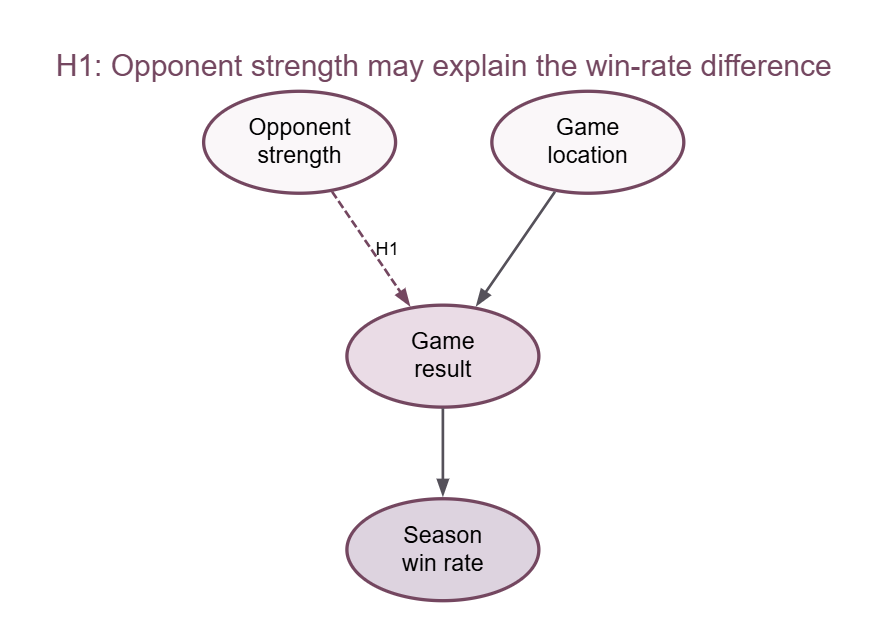
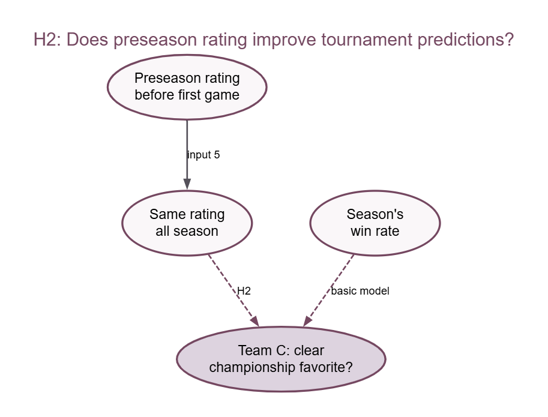

## Specific problem

Team C won 85.7% of its 2026 regular-season games, compared with 70.0% for Team A. However, Team C faced much weaker opponents. We need to check whether its higher win rate still makes it look stronger when both teams are compared against the same level of opposition.

## Hypothesis 1 — Opponent strength

**If Team C's higher win rate is mainly due to facing weaker opponents, then Team A will have a higher estimated chance of winning than Team C after we account for opponent strength.**

Opponent strength is the factor missing from the raw win-rate comparison. We can measure it using each opponent's preseason rating. The rating is available before the games, so it does not use the game's result to judge the opponent.

### Planned test
Use 2015–2025 games to estimate how teams’ and opponents’ preseason ratings and game location relate to wins. Then use Team A’s and Team C’s 2026 results to estimate how each would perform against the same mix of opponents and locations, drawn from their combined 2026 schedules. Compare those adjusted win rates.

**Prediction:** Team A’s adjusted win rate will be higher than Team C’s when both are evaluated against the same mix of opponents and locations.

**What would contradict H1:** Team C's estimated chance is equal to or higher than Team A's.

We will report the number of games and uncertainty for each estimate, especially because Team C played very few strong opponents.

## Hypothesis 2 — Does preseason rating add useful information?

**If preseason ratings tell us something that win rates miss, then using both should give us more accurate estimates of tournament success than using win rate alone.**

Team C has the higher 2026 win rate, but Team A had the stronger preseason rating. This hypothesis asks whether that difference in preseason expectations is useful when judging the model's claim about Team C.

### Planned test

We will compare a model using only regular-season win rate with one that also uses preseason rating. Both estimate whether a team wins at least one main-bracket game; teams that do not enter count as having no win.

Starting with 2015–2019, we will check each model on the next completed season, add that season to the training data, and repeat through 2025. We skip 2020 because there was no tournament. We will compare their Brier scores before applying both models to Team A and Team C in 2026.

**Prediction:** The model using both win rate and preseason rating will have a lower Brier score.

**What would contradict H2:** Adding preseason rating gives the same or a higher Brier score.

We will then compare both models' 2026 estimates for Team A and Team C. These estimates measure the chance of winning a main-bracket game, not the championship.